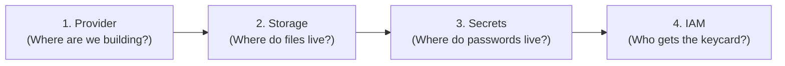

# 🧠 Terraform Masterclass: Mental Models, Code Generation & Senior Interview Guide

> **Note:** This is your internal study guide and interview playbook. It breaks down the architecture into intuitive mental models (explainable to a 15-year-old), gives you a 4-step formula to generate Terraform code from scratch, and arms you with 10 senior-level interview scenarios and answers.

---

## 🧒 Part 1: Explain Terraform Like I'm 15 (The Lego Blueprint Analogy)

Imagine **Amazon Web Services (AWS)** is the world's largest Lego warehouse with millions of servers, hard drives, and databases.

* **The Old, Painful Way (Clicking in the Console):**  
  You log into a website, click 50 buttons, check random checkboxes, and hope you didn't forget anything. If you need to rebuild it tomorrow for testing, you have to remember all 50 clicks again. If you make one mistake, your bank or company app crashes.
* **The Terraform Way (The Master Blueprint):**  
  Instead of clicking around, you write an order sheet in plain text:
  > *"Hey Terraform: build me 1 storage locker, 1 secret safe for my passwords, and give this specific robot a keycard that ONLY opens those two things."*  
  Then you type `terraform apply`. Terraform talks to AWS and builds the whole setup in 30 seconds. Exactly the same, every single time.

---

## 🔑 Part 2: The 3 Core Concepts You Must Know

### 1. Declarative vs Imperative
* **Imperative (Like a recipe):** *"Turn on the oven. Take out 2 eggs. Crack the eggs. Stir for 2 minutes."* If you run it twice, you get 4 eggs.
* **Declarative (Terraform):** *"I want 1 hot pizza on the table."* You don't care how Terraform makes it; you just declare the **desired end-state**. If the pizza is already there, Terraform does nothing (`0 to add, 0 to change`).

### 2. Idempotency (The Superpower)
If you run `terraform apply` 10 times in a row without changing your code, it only builds the infrastructure on the 1st run. On runs 2 through 10, it verifies everything matches your blueprint and says: **"No changes. Your cloud matches your code."**

### 3. The State File (`terraform.tfstate`)
Think of `terraform.tfstate` as the **receipt and inventory list**. It maps the names in your code (`aws_s3_bucket.ai_artifacts`) to the real IDs assigned by Amazon (`scalable-ai-telemetry-prod-abc123`).

---

## 🛠️ Part 3: The 4-Step Formula to Generate Terraform from Scratch

Whenever you are faced with a blank file in a coding challenge or interview, use this mental checklist:



### Step 1: Declare the Provider
Tell Terraform which cloud you are using and which city/region:
```hcl
provider "aws" {
  region = "eu-central-1" # Frankfurt
}
```

### Step 2: Declare Storage (`aws_s3_bucket`) + Security Add-ons
Create the bucket, then snap on the 3 security features every bank requires:
```hcl
# The Bucket
resource "aws_s3_bucket" "ai_artifacts" {
  bucket = "my-ai-telemetry-bucket-unique-123"
}

# The Time Machine (Versioning)
resource "aws_s3_bucket_versioning" "v" {
  bucket = aws_s3_bucket.ai_artifacts.id
  versioning_configuration { status = "Enabled" }
}

# The Scrambler (Encryption)
resource "aws_s3_bucket_server_side_encryption_configuration" "e" {
  bucket = aws_s3_bucket.ai_artifacts.id
  rule {
    apply_server_side_encryption_by_default { sse_algorithm = "AES256" }
  }
}

# The Deadbolt (Block Public Access)
resource "aws_s3_bucket_public_access_block" "pab" {
  bucket                  = aws_s3_bucket.ai_artifacts.id
  block_public_acls       = true
  block_public_policy     = true
  ignore_public_acls      = true
  restrict_public_buckets = true
}
```

### Step 3: Declare the Password Safe (`aws_secretsmanager_secret`)
Never write API keys in code! Put them in Secrets Manager:
```hcl
resource "aws_secretsmanager_secret" "api_keys" {
  name = "ai-platform/credentials"
}

resource "aws_secretsmanager_secret_version" "val" {
  secret_id     = aws_secretsmanager_secret.api_keys.id
  secret_string = jsonencode({
    OPENAI_API_KEY = var.openai_api_key
  })
}
```

### Step 4: The Least-Privilege Keycard (`aws_iam_role` & `aws_iam_policy`)
Give the app an execution badge that **only** opens that bucket and reads that secret:
```hcl
# The Badge (Role)
resource "aws_iam_role" "app_role" {
  name = "ai-app-execution-role"
  assume_role_policy = data.aws_iam_policy_document.trust.json
}

# The Permissions Written on the Badge (Policy)
data "aws_iam_policy_document" "permissions" {
  statement {
    actions   = ["s3:PutObject", "s3:GetObject"]
    resources = ["${aws_s3_bucket.ai_artifacts.arn}/*"]
  }
  statement {
    actions   = ["secretsmanager:GetSecretValue"]
    resources = [aws_secretsmanager_secret.api_keys.arn]
  }
}

resource "aws_iam_policy" "policy" {
  name   = "ai-least-privilege-policy"
  policy = data.aws_iam_policy_document.permissions.json
}

resource "aws_iam_role_policy_attachment" "attach" {
  role       = aws_iam_role.app_role.name
  policy_arn = aws_iam_policy.policy.arn
}
```

---

## ⚡ Part 4: The 3 Commands You Run Every Day

1. **`terraform init`** $\rightarrow$ Downloads the AWS driver/plugin onto your laptop.
2. **`terraform plan`** $\rightarrow$ "Preview Mode": Shows green `+` for what will be added, yellow `~` for changes, and red `-` for deletions. *(Zero money spent, zero changes made yet).*
3. **`terraform apply`** $\rightarrow$ "Execute": Actually calls AWS APIs and builds the cloud resources.

---

## 🎤 Part 5: 10 Senior Interview Questions & Model Answers

### Q1: "Explain how Terraform manages state and why remote state is critical."
> **Winning Answer:**  
> *"Terraform uses a state file (`terraform.tfstate`) as a single source of truth mapping declared HCL code to real-world cloud resource IDs and metadata. If stored locally on a developer's laptop, state cannot be shared across the team, risks accidental loss, and exposes sensitive values in plaintext.  
> In enterprise environments, we store state in a **remote S3 backend with server-side encryption and DynamoDB state locking**. This guarantees that all team members and CI/CD pipelines operate against the same state while preventing concurrent executions."*

### Q2: "What is 'State Drift' and how do you detect and resolve it?"
> **Winning Answer:**  
> *"State drift occurs when real-world cloud infrastructure is modified outside of Terraform—such as someone manually tweaking a security group rule or S3 policy in the AWS Console.  
> Terraform detects drift during `terraform plan` or `terraform plan -refresh-only` by querying live AWS APIs and diffing them against the state file. To resolve it, we either run `terraform apply` to overwrite manual changes and restore declarative truth, or if the manual change was valid, we update the HCL code to reflect it and run a refresh."*

### Q3: "What is DynamoDB State Locking and what happens if two engineers run `terraform apply` simultaneously?"
> **Winning Answer:**  
> *"Without state locking, concurrent applies would read the same state, make conflicting AWS API calls, and corrupt the state file (a race condition).  
> When configured with a DynamoDB lock table, Terraform writes an item with a unique `LockID` at the start of any command that mutates state. If another engineer or CI runner triggers `apply` at the same moment, Terraform checks DynamoDB, sees the active lock, and immediately aborts with an error: `'Error acquiring the state lock'`. The lock is released only when the first execution completes."*

### Q4: "How do you handle secrets (API keys, DB credentials) in Terraform without leaking them in Git or state?"
> **Winning Answer:**  
> *"We follow a defense-in-depth approach:  
> 1. Mark variables as `sensitive = true` so Terraform masks them from CLI outputs, logs, and plan previews.  
> 2. Never hardcode secrets in `.tf` or commit `.tfvars` to Git. Instead, inject them via environment variables (`TF_VAR_openai_api_key`) or fetch them dynamically from HashiCorp Vault or AWS Secrets Manager.  
> 3. Protect the remote state file itself: Since Terraform state necessarily contains secret values in raw JSON, we ensure the remote S3 state bucket enforces AES-256/KMS encryption and restricts access via tightly scoped IAM policies."*

### Q5: "How do you structure Terraform for Multi-Environment Deployments (Dev, Staging, Prod)?"
> **Winning Answer:**  
> *"While Terraform offers Workspaces, in regulated financial environments we prefer **directory-based separation** or **Terragrunt** over workspaces.  
> Workspaces share the same backend bucket and configuration, increasing blast radius. Directory separation (`environments/dev`, `environments/prod`) allows completely isolated AWS accounts, separate IAM access credentials, independent remote state files, and environment-specific variable overrides. A mistake in Dev state can never corrupt Prod."*

### Q6: "How do you import existing infrastructure that was manually created into Terraform?"
> **Winning Answer:**  
> *"Historically, we used the CLI command `terraform import aws_s3_bucket.my_bucket bucket-name-123`, which brought the resource into the state file, requiring us to write the matching HCL code manually.  
> Since Terraform 1.5, we use the declarative `import {}` block:  
> ```hcl
> import {
>   to = aws_s3_bucket.ai_artifacts
>   id = "scalable-ai-telemetry-prod"
> }
> ```  
> We can then run `terraform plan -generate-config-out=generated.tf`, and Terraform will automatically generate the corresponding HCL code for us. This is faster, reproducible, and reviewable in pull requests."*

### Q7: "What is `lifecycle { create_before_destroy = true }` and why is it important?"
> **Winning Answer:**  
> *"By default, when Terraform needs to replace a resource that cannot be updated in-place, it destroys the existing resource first and then creates the new one. This causes downtime.  
> Using `create_before_destroy = true` reverses this sequence: Terraform provisions the replacement resource first, verifies it is healthy, updates references, and only then tears down the old resource. This is crucial for zero-downtime updates on load balancers, DNS records, and autoscaling launch templates."*

### Q8: "What does it mean when a resource is 'Tainted'?"
> **Winning Answer:**  
> *"When a resource creation begins during `terraform apply` but fails halfway through (for example, a timeout during a script execution), Terraform marks that resource as 'tainted' in the state file. On the next `terraform apply`, Terraform knows the resource is in an incomplete or unhealthy state, so it automatically destroys and recreates it."*

### Q9: "What are Terraform Modules and when should you create them?"
> **Winning Answer:**  
> *"A Terraform module is a container for multiple resources that are used together. Every configuration has a root module, but we create reusable child modules (e.g. `modules/secure-s3-bucket` or `modules/microservice-ecs`) to encapsulate organizational standards—such as default tags, mandatory encryption, and public access blocks. This allows developers across teams to instantiate compliant infrastructure with just 5 lines of code instead of 100."*

### Q10: "How do you enforce Policy-as-Code and security scanning before Terraform applies to production?"
> **Winning Answer:**  
> *"We embed static analysis and policy engines directly into our CI/CD pull request pipeline:  
> 1. **Checkov / tfsec:** Scans HCL code for security misconfigurations (e.g., flagging unencrypted S3 buckets or wildcard IAM permissions) before code merges.  
> 2. **TFLint:** Enforces naming conventions and checks for invalid AWS instance types.  
> 3. **Open Policy Agent (OPA) / Conftest or Sentinel:** Validates the generated `tfplan.json` against organizational compliance policies, automatically blocking PRs that violate security rules."*

---

## 🎯 Part 6: The 30-Second Interview Pitch

When an interviewer says: *"Walk me through your experience with Terraform"*, deliver this concise, confident summary:

> *"I write modular, declarative Terraform configurations following production security standards. For example, in my cloud telemetry stack, I provisioned an S3 bucket configured with versioning, AES-256 encryption, public access blocks, and lifecycle transitions to Glacier for FinOps cost optimization. I integrated AWS Secrets Manager for LLM API credentials and tied the infrastructure together using least-privilege IAM execution roles strictly scoped to resource ARNs. I manage state using remote S3 backends with DynamoDB locking to ensure zero state corruption across teams."*
