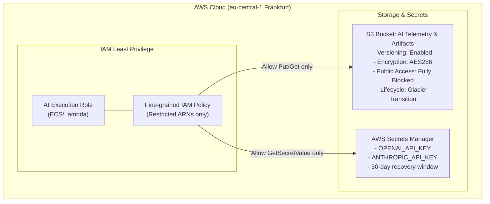

# Terraform (IaC) for AWS Cloud & GenAI Platforms


> **Target Mastery:** Infrastructure as Code (IaC), AWS Architecture, State Locking, Secrets Management, Least-Privilege IAM.

---

## 📖 1. What is Terraform & Why Does Modern Fintech Use It?

**Infrastructure as Code (IaC)** allows you to define, provision, and version cloud infrastructure using declarative configuration files rather than clicking manually in the AWS Management Console.

* **Declarative vs Imperative:** In declarative tools (Terraform), you specify the *desired end-state* (`"I want an S3 bucket with encryption enabled"`). Terraform calculates the delta and executes the minimum necessary API calls. In imperative scripts (Bash, Python Boto3), you have to program step-by-step logic and check manually if resources already exist.
* **Idempotency:** Running `terraform apply` once creates the resources. Running it a second time with no code changes does nothing (`0 to add, 0 to change, 0 to destroy`).
* **Reproducibility:** A single codebase can stamp out identical `dev`, `staging`, and `prod` environments across AWS regions (`eu-central-1` Frankfurt).

---

## 🏗️ 2. Architectural Blueprint of this Project

The code in `main.tf` provisions a secure, audit-ready AI telemetry stack:



---

## 🧩 3. Key Concepts Explained Simply

### A. The Terraform State (`terraform.tfstate`)
* **What it is:** A JSON file mapping your declared configuration to real-world cloud resource IDs and attributes.
* **Why it matters:** When you edit a resource name or tag, Terraform consults state to know which cloud resource needs updating.
* **The Golden Rule:** Never edit `terraform.tfstate` by hand.
* **Remote State & State Locking:**
  In a production environment (like Scalable Capital), state is stored centrally in **AWS S3** with **DynamoDB** state locking:
  ```hcl
  backend "s3" {
    bucket         = "scalable-tf-state-prod"
    key            = "ai-platform/terraform.tfstate"
    region         = "eu-central-1"
    dynamodb_table = "terraform-state-lock"
    encrypt        = true
  }
  ```
  *When a developer or CI/CD pipeline runs `terraform apply`, Terraform acquires a lock item in DynamoDB. Any concurrent run fails fast with an error, preventing race conditions and corrupted cloud states.*

### B. Principle of Least Privilege (PoLP)
In fintech and regulated environments (BaFin/Finantsinspektsioon), granting `s3:*` or `Resource: "*"` is an instant security audit failure.
Notice how our `main.tf` restricts IAM permissions:
```hcl
statement {
  sid       = "AllowS3ObjectRWOnAIBucketOnly"
  effect    = "Allow"
  actions   = ["s3:PutObject", "s3:GetObject", "s3:ListBucket"]
  resources = [
    aws_s3_bucket.ai_artifacts.arn,
    "${aws_s3_bucket.ai_artifacts.arn}/*"
  ]
}
```
The AI service cannot touch any other company bucket, list unapproved files, or delete data.

### C. Secrets Manager vs Environment Variables
Hardcoding API keys in code or dockerfiles exposes credentials to source control and image registries.
* With **AWS Secrets Manager**, API keys are encrypted at rest with AWS KMS.
* Applications retrieve them dynamically at runtime or inject them into container runtime memory via ECS task definitions without exposing them to developers or build logs.

---

## ⚡ 4. The 5 Essential Terraform Commands

| Command | What it does | When to run it |
| :--- | :--- | :--- |
| `terraform init` | Downloads provider plugins (AWS, Random) and initializes the backend | First time setting up or after adding providers |
| `terraform fmt` | Rewrites config files to canonical format and style | Before committing code |
| `terraform validate` | Verifies syntax and internal consistency of configurations | In CI/CD pipelines before planning |
| `terraform plan` | Creates an execution plan; previews what will be added, changed, or destroyed | Mandatory before making changes |
| `terraform apply` | Executes the actions proposed in the plan | When deploying infrastructure |
| `terraform destroy` | Destroys all remote objects managed by this configuration | When tearing down test environments |

---

## 🎤 5. Senior Interview Questions & How to Answer Them

### Q1: "How do you handle secrets (like LLM API keys or database passwords) in Terraform without committing them to Git?"
> **Winning Answer:**  
> *"First, never store plaintext secrets in `.tf` or `.tfvars` files committed to Git. In Terraform, we define variables as `sensitive = true` so Terraform masks them from CLI stdout and log outputs. In production, we either inject them at runtime via environment variables (`TF_VAR_openai_api_key`), pass them from a secure CI/CD vault (e.g., GitHub Actions Secrets or HashiCorp Vault), or better yet, use Terraform only to declare the `aws_secretsmanager_secret` container, and let external secret management pipelines populate the secret payload."*

### Q2: "What is 'State Drift' and how do you detect and resolve it?"
> **Winning Answer:**  
> *"State drift occurs when the real-world infrastructure changes outside of Terraform—for example, if someone manually edits a security group or S3 bucket policy in the AWS Console. Terraform detects drift by querying AWS APIs during `terraform plan` or `terraform plan -refresh-only` and comparing actual cloud state with `terraform.tfstate`. To resolve it, we either run `terraform apply` to overwrite manual changes and restore declarative truth, or if the change was deliberate, import and reflect it in our `.tf` code."*

### Q3: "How do you structure Terraform code across dev, staging, and prod?"
> **Winning Answer:**  
> *"There are two primary paradigms: Terraform Workspaces vs Directory-based isolation (or Terragrunt). In high-compliance fintech environments like Scalable Capital, directory separation or Terragrunt with isolated AWS accounts per environment is preferred over simple workspaces. This provides hard blast-radius isolation, distinct IAM credentials, separate state files, and prevents a mistake in dev state from impacting prod."*

---

## 🧪 6. Hands-On Verification Test

If you have AWS CLI and Terraform installed locally, you can test this configuration:
```bash
cd sprint_projects/01_terraform_aws
terraform init
terraform validate
terraform plan
```
*(If you do not have active AWS credentials configured yet, `terraform validate` will verify syntax and dependency graph without calling AWS APIs!)*
