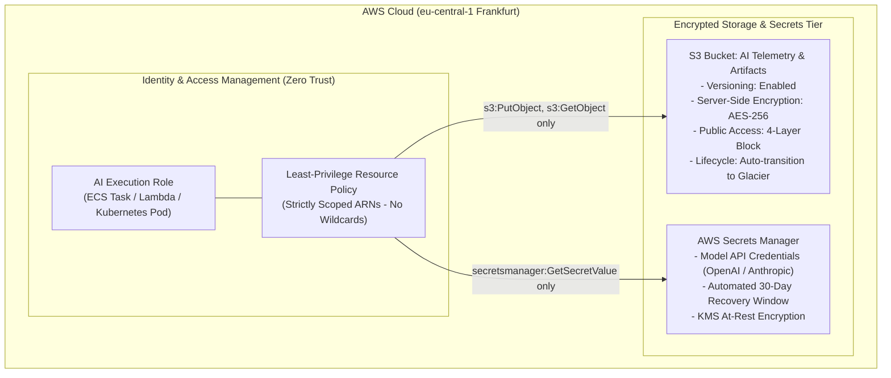

# Terraform (IaC) for AWS Cloud & GenAI Platforms


> **Target Mastery:** Infrastructure as Code (IaC), AWS Architecture, State Locking, Secrets Management, Least-Privilege IAM.

---

## 🏛️ Architecture Overview



---

## 🔒 Security & Compliance Specifications

| Security Domain | Implementation | Compliance Objective |
| :--- | :--- | :--- |
| **Data Encryption at Rest** | `aws_s3_bucket_server_side_encryption_configuration` (AES256) + AWS KMS | Prevents physical disk extraction and satisfies GDPR Article 32 |
| **Public Exposure Prevention** | `aws_s3_bucket_public_access_block` (All 4 flags enforced) | Prevents data leaks, accidental open buckets, and external snooping |
| **Auditability & Recovery** | `aws_s3_bucket_versioning` (Enabled) | Protects against accidental deletion, malicious writes, and enables point-in-time recovery |
| **FinOps Cost Management** | `aws_s3_bucket_lifecycle_configuration` | Automatically transitions telemetry logs to `STANDARD_IA` at 60 days, `GLACIER` at 180 days, expires at 730 days |
| **Least Privilege IAM** | `aws_iam_policy` strictly scoped to generated resource ARNs | Eliminates wildcard (`*`) attack vectors; adheres to BaFin MaRisk / ISO 27001 standards |
| **Secret Protection** | `aws_secretsmanager_secret` with variable masking (`sensitive = true`) | Prevents plain-text credential leaks in CI/CD logs, git commits, or console outputs |

---

## 📂 Repository Structure

```
.
├── main.tf                  # Primary infrastructure declarations (S3, Secrets Manager, IAM)
├── variables.tf             # Input variable declarations, types, defaults, and validation blocks
├── outputs.tf               # Exported resource ARNs and identifiers for downstream services
├── terraform.tfvars.example # Template parameter file for environment configuration
├── push_to_github.ps1       # Automated GitHub repository synchronization script
└── INTERVIEW_STUDY_GUIDE.md # (Local Study) Architectural deep-dive & interview scenarios
```

---

## 🚀 Deployment Guide

### Prerequisites
* [Terraform CLI](https://developer.hashicorp.com/terraform/downloads) `>= 1.5.0`
* [AWS CLI v2](https://docs.aws.amazon.com/cli/latest/userguide/getting-started-install.html) configured with active credentials (`aws configure`)
* Permissions to provision S3, Secrets Manager, and IAM resources in target account

### 1. Initialize Working Directory
Downloads required provider plugins (`hashicorp/aws`, `hashicorp/random`):
```bash
terraform init
```

### 2. Configure Environment Parameters
Copy the template configuration file:
```bash
cp terraform.tfvars.example terraform.tfvars
```
Edit `terraform.tfvars` with your targeted parameters:
```hcl
aws_region        = "eu-central-1"
environment       = "prod"
project_name      = "scalable-ai-telemetry"
openai_api_key    = "sk-proj-your-actual-key"
anthropic_api_key = "sk-ant-your-actual-key"
```

### 3. Validate & Review Plan
Generate and inspect the speculative execution plan:
```bash
terraform validate
terraform plan -out=tfplan
```

### 4. Apply Changes
Provision the infrastructure on AWS:
```bash
terraform apply tfplan
```

### 5. Verify Outputs
```bash
terraform output
```

---

## ⚙️ Module Inputs

| Name | Description | Type | Default | Required |
| :--- | :--- | :--- | :--- | :---: |
| `aws_region` | AWS region where resources are deployed | `string` | `"eu-central-1"` | no |
| `environment` | Deployment target (`dev`, `staging`, `prod`) | `string` | `"prod"` | no |
| `project_name` | Identifier prefixed to all created cloud resources | `string` | `"scalable-ai-telemetry"` | no |
| `openai_api_key` | OpenAI API key stored in Secrets Manager (masked) | `string` | `""` | yes |
| `anthropic_api_key` | Anthropic API key stored in Secrets Manager (masked) | `string` | `""` | yes |

---

## 📤 Module Outputs

| Name | Description |
| :--- | :--- |
| `s3_bucket_name` | Globally unique name of the provisioned AI telemetry S3 bucket |
| `s3_bucket_arn` | Amazon Resource Name (ARN) of the telemetry bucket |
| `secrets_manager_secret_arn` | ARN of the Secrets Manager container storing LLM credentials |
| `iam_execution_role_arn` | ARN of the least-privilege IAM execution role for compute workloads |
| `iam_execution_role_name` | Identifier name of the created IAM execution role |

---

## 🧹 Teardown

To decommission all managed resources when tearing down ephemeral testing environments:
```bash
terraform destroy
```
